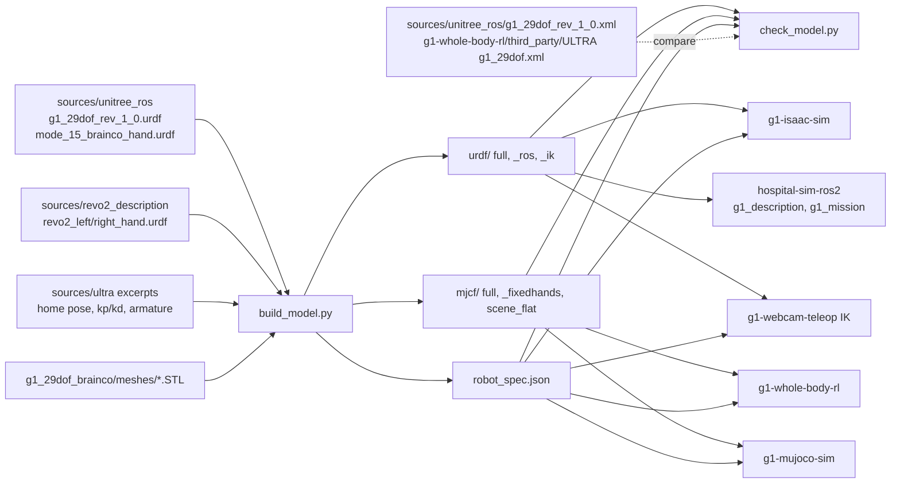

# g1-brainco-description: G1 29-DoF plus BrainCo Revo2 robot model

This repository holds the robot model that every other repository uses. The model is the Unitree G1 29-DoF
rev 1.0 with BrainCo Revo2 hands. The repository provides it as a URDF and as an MJCF, with meshes and a
machine-readable `robot_spec.json`. The consumers are `g1-whole-body-rl`, `g1-mujoco-sim`, `g1-isaac-sim`,
`g1-webcam-teleop`, and the `g1_description` and `g1_mission` packages in `hospital-sim-ros2`. The build and
the checks need no sibling repository. The script `check_model.py` also compares the model against ULTRA's MJCF
when `g1-whole-body-rl` is checked out beside this repository with its `third_party/ULTRA` submodule.

The master repository `hospital-sim` clones all of these repositories side by side. It provides `env.sh`, which
activates the shared `.venv` with mujoco. Paths in this README are relative to this repository unless they name
a sibling repository or the master (`env.sh`, `docs/interfaces.md`). Run the commands from the root of the
master checkout.

The script `build_model.py` generates the files under `g1_29dof_brainco/{urdf,mjcf}` and `robot_spec.json`. Do
not edit these files by hand. The file `SOURCE.md` lists the upstream commits, the licences and every modelling
decision. This README summarises it.

## How it works

The script `build_model.py` reads three vendored upstream text files from `sources/` and the STL meshes from
`g1_29dof_brainco/meshes/`. The file `sources/unitree_ros/g1_29dof_rev_1_0.urdf` gives the body: the links, the
inertials, the joint limits, and the frames of the IMU, the MID-360 and the D435. The file
`sources/unitree_ros/g1_29dof_mode_15_brainco_hand.urdf` gives only the wrist adapter link (`*_base2_link`,
22.8 g) and the hand mount transform. The files `sources/revo2_description/revo2_{left,right}_hand.urdf` give
the hands, with 6 actuated and 5 mimic-coupled joints per side.

The function `build_urdf()` removes Unitree's rubber hands and the `<mujoco>` hint. It rewrites every mesh path
to `../meshes/g1/` or `../meshes/revo2_<side>_hand/`. It appends the adapter, the mount (renamed
`*_hand_mount_joint`) and the hand, and returns one `ElementTree`. The script derives two variants from this
tree. The `_ros.urdf` variant swaps the mesh prefix for `package://g1_description/meshes/`. The `_ik.urdf`
variant turns every hand joint into `fixed`, so pinocchio sees nq = 29.

The MJCF does not come from MuJoCo's URDF importer. The function `urdf_to_tree()` parses the URDF into a body
tree. The function `fuse_static()` folds every joint-less link into its moving parent. It combines the mass,
the COM and the inertia with the parallel-axis theorem. It leaves a `<site>` named after the fused link, so
`imu_in_pelvis`, `mid360_link`, `d435_link`, `*_tip_link` and the rest stay addressable.

The function `write_mjcf()` then emits the bodies, the joints, the meshes and the collision classes. It emits
10 `<equality><joint>` constraints for the mimic couplings. It emits 29 `motor` actuators in the contract joint
order of `docs/interfaces.md` section 2, with `ctrlrange` equal to plus or minus the URDF effort. It emits 12
hand `position` actuators: left 6 then right 6, in the slots thumb, thumb_aux, index, middle, ring, pinky. It
emits the unitree_mujoco sensor layout.

The body-joint armature, the home pose and the kp/kd in `robot_spec.json` are ULTRA's released values. The
effort limits come from the pinned Unitree URDF. The ankles and the waist roll/pitch are 35 N m, where ULTRA
and the vendor MJCF have 50 N m. The function `add_keyframe()` loads the written XML with mujoco. It solves the
pelvis height so that the 8 sole spheres rest on z = 0 (0.7842 m), then writes the `home` key.

The second MJCF pass runs with `fixed_hands=True`. It drops the hand joints, fuses the fingers open into
`*_wrist_yaw_link`, and disables all non-sole collision geoms for MJX speed. The file `scene_flat.xml` is a
floor, lights and an `<include>` of the full model. Last, the script writes `robot_spec.json` and
`sources/mesh_manifest.json` (the SHA-256 of every STL). The option `--fetch` first re-clones the pinned
commits into `~/.cache/hospital_g1_robot_sources` and refreshes `sources/` and `meshes/`.

The script `check_model.py` imports the constants from `build_model.py` and runs 29 checks on the outputs (see
Test / check).

## Architecture



This table lists the main pieces of the repository.

| Piece | File | Role |
|---|---|---|
| Builder | `build_model.py` | Assembles the URDF from `sources/`, writes the three URDF and three MJCF variants, `robot_spec.json` and `sources/mesh_manifest.json`; `--fetch` re-downloads the pinned upstream commits |
| Checker | `check_model.py` | 29 PASS/WARN/FAIL checks plus INFO comparisons against the Unitree vendor MJCF and ULTRA's MJCF; exit code 1 on any FAIL |
| Pinned inputs | `sources/` | Vendored URDF/MJCF text files, upstream LICENSE files, `motor_info.md`, ULTRA code excerpts, `mesh_manifest.json` |
| Provenance | `SOURCE.md` | Upstream commits, licences, 19 modelling decisions, table of known disagreements |
| Outputs | `g1_29dof_brainco/` | `urdf/`, `mjcf/`, `meshes/`, `robot_spec.json` (see Layout) |

## Dependencies

This table lists the system dependencies.

| Item | Version here | Needed for |
|---|---|---|
| Ubuntu | 22.04.5 LTS | |
| Python (`.venv`, system interpreter with system site-packages) | 3.10.12 | both scripts; `build_model.py` accepts any Python 3.8 or newer |
| git | 2.34.1 | `build_model.py --fetch` only (sparse clones of the pinned commits) |
| ROS 2 Humble: `robot_state_publisher`, `joint_state_publisher_gui`, `rviz2` | apt | only the `g1_description` launch files in `hospital-sim-ros2`, which install this repository's `_ros.urdf` and meshes |

This table lists the third-party Python imports of `build_model.py` and `check_model.py`. The versions come
from the `.venv` freeze `venv_local.txt`, and `requirements.txt` pins them.

| Package | Version | Used by | Notes |
|---|---|---|---|
| `mujoco` | 3.14.0 | both | `build_model.py` needs it for the home keyframe and `robot_spec.json`; `check_model.py` for everything |
| `numpy` | 1.26.4 | both | |
| `pin` (pinocchio) | 3.9.0 | `check_model.py` only | optional: the pinocchio checks are skipped with an INFO line when it is not importable. Installed in `.venv` from a local wheel of the PyPI `pin` 3.9.0 release |

Everything else that the scripts import is standard library (`argparse`, `copy`, `hashlib`, `json`, `math`,
`re`, `shutil`, `subprocess`, `sys`, `xml.etree.ElementTree`, `pathlib`). The scripts use no YAML and no lxml.

The repository needs no data or assets outside git. The meshes are committed under `g1_29dof_brainco/meshes/`
and checked against `sources/mesh_manifest.json`. The option `--fetch` downloads from GitHub (unitree_ros,
revo2_description). The optional ULTRA comparison reads
`g1-whole-body-rl/third_party/ULTRA/ultra/data/assets/g1/g1_29dof.xml`. That file is in a git submodule of
`g1-whole-body-rl` pinned at `ec972c7`.

This table lists the pinned upstream sources and their licences; the full table is in `SOURCE.md`.

| Source | Commit | Licence |
|---|---|---|
| [unitreerobotics/unitree_ros](https://github.com/unitreerobotics/unitree_ros) `robots/g1_description`, `robots/g1_with_brainco_hand` | `da52948f` (2026-09-29) | BSD-3-Clause, `sources/unitree_ros/LICENSE` |
| [BrainCoTech/revo2_description](https://github.com/BrainCoTech/revo2_description) | `92cc697c` (v1.0.0 + 2026-08-20) | Apache-2.0, `sources/revo2_description/LICENSE` |
| [Sirui-Xu/ULTRA](https://github.com/Sirui-Xu/ULTRA) home pose, PD gains, armature (excerpts) | `ec972c7a` | Apache-2.0, `sources/ultra/LICENSE` |
| BrainCo Revo2 docs (joint semantics and ranges) | web page | no licence stated |

## Install

Run these commands from a fresh clone of the master repository. The steps are:

1. Clone the master repository and enter it.
2. Install `vcstool` and import every component repository.
3. Create `.venv` only if it does not exist yet; `env.sh` activates it.
4. Source `env.sh` and install the pinned Python packages into `.venv`.

```bash
git clone https://github.com/Bkrakshith/hospital-sim.git Hospital_G1
cd Hospital_G1
pip install vcstool
vcs import < hospital-sim.repos
python3 -m venv --system-site-packages .venv       # only if .venv does not exist yet; env.sh activates it
source env.sh
.venv/bin/pip install -r g1-brainco-description/requirements.txt
```

No build step is needed, because the generated model is committed. Rebuild the model only after you edit
`build_model.py`. The package `g1_description` in `ros2_ws` picks the files up when you run `colcon build`
(`source env.sh && (cd ros2_ws && colcon build --symlink-install)`).

## Run

Open the full model in the MuJoCo viewer. The command shows the model on a flat floor, at the `home` key.

```bash
source env.sh
.venv/bin/python -m mujoco.viewer --mjcf g1-brainco-description/g1_29dof_brainco/mjcf/scene_flat.xml
```

Rebuild the model. The command regenerates every file under `g1_29dof_brainco/{urdf,mjcf}`, `robot_spec.json`
and `sources/mesh_manifest.json` from `sources/` and `meshes/`. It prints one line: `wrote ...: full nq=58
nu=41 mass=33.827 kg; fixedhands nq=36 nu=29 ...; home pelvis z=0.7842 m`. It exits with `missing meshes (run
with --fetch)` if a mesh is absent.

```bash
.venv/bin/python g1-brainco-description/build_model.py
```

Rebuild the model with fresh sources. The command does the same as above, but it first re-downloads the pinned
upstream commits as sparse git clones. The default cache is `~/.cache/hospital_g1_robot_sources`. It refreshes
`sources/` and `meshes/`. It needs network access and git.

```bash
.venv/bin/python g1-brainco-description/build_model.py --fetch [--cache DIR]
```

Show the model in ROS 2. The first command runs `robot_state_publisher` on `_ros.urdf`; it needs a
`colcon build` of `ros2_ws` first. The second command does the same and adds RViz and
`joint_state_publisher_gui`.

```bash
ros2 launch g1_description description.launch.py use_sim_time:=true   # variant:=full|ik
ros2 launch g1_description view.launch.py                             # RViz + joint sliders
```

## Test / check

Run the checker. The check takes about 6 s and must end with `27 PASS, 2 WARN, 0 FAIL` (exit 0).

```bash
source env.sh
taskset -c 0-7,10-31 .venv/bin/python g1-brainco-description/check_model.py [--ultra PATH] [--hold 3]
```

The two WARN lines come from the zero-action PD hold with ULTRA kp/kd. That hold falls at 0.834 s on both
models; see "Things every consumer must know". This table lists the 29 checks by group.

| Group | Count | What is checked |
|---|---|---|
| Meshes | 3 | every mesh referenced by the three URDFs exists (132 refs each) |
| Load | 1 | mujoco loads full (nq 58, nv 57, nu 41, neq 10), fixedhands (nq 36, nu 29) and scene_flat |
| Order | 5 | body joints in contract order in qpos (full: relative order, fixedhands: exactly `qpos[7:36]`); actuators 0..28 drive the body joints in order; actuators 29..40 are left then right hand slots |
| Mass | 2 | full and fixedhands total mass equal (33.8268 kg) with equal wrist subtree masses; sole sphere geometry identical (8 spheres, r 5 mm) |
| Home and hold | 8 | per model: home joints equal ULTRA `default_dof_pos`; feet rest on z = 0 with no penetration; ULTRA-gain PD hold for 3 s (WARN if it falls after 1 s, as it does); stiff test PD (500/10 legs, 100/3 arms) must stand |
| Hands | 2 | all 12 hand actuators reach their upper limit within 1 s (max error 0.0003 rad); 10 mimic constraints hold (worst violation 0.0000 rad) |
| URDF vs MJCF | 4 | same 51 joints; body poses, joint axes and ranges agree to 1e-6 at 5 random configurations (measured 4e-9); masses, COMs and inertias agree (1e-10); URDF effort equals motor `ctrlrange` or hand `forcerange` for all 41 actuators. The reference is MuJoCo's own URDF importer, an independent converter |
| pinocchio | 4 | `pin` 3.9.0 loads the full URDF (nq 51: mimic joints become independent) and `_ik.urdf` (nq 29); locking legs and waist leaves nq 14; FK of hand bases, `mid360_link` and a fingertip matches MuJoCo site poses (1e-9) |

The INFO lines list every difference against the Unitree vendor MJCF (13) and ULTRA's `g1_29dof.xml` (14):
effort limits, MID-360 pose, wrist and total mass, armature. These differences are expected, and `SOURCE.md`
explains them.

## Layout

This table lists the files and folders of the repository.

| Path | What |
|---|---|
| `build_model.py` | regenerates everything under `g1_29dof_brainco/` except `meshes/`; `--fetch` re-downloads sources and meshes |
| `check_model.py` | the 29 checks above; exit 1 on FAIL |
| `requirements.txt` | pinned Python dependencies for the shared `.venv` |
| `SOURCE.md` | upstream commits, licences, modelling decisions, known disagreements |
| `sources/unitree_ros/` | `g1_29dof_rev_1_0.urdf`, `g1_29dof_rev_1_0.xml` (vendor MJCF, comparison only), `g1_29dof_mode_15_brainco_hand.urdf`, `motor_info.md`, `LICENSE` |
| `sources/revo2_description/` | `revo2_left_hand.urdf`, `revo2_right_hand.urdf`, `package.xml`, `LICENSE` |
| `sources/ultra/` | excerpts of `humanoid_g1.py` and `sim2sim_teacher.py` with the gains and home pose, `LICENSE` |
| `sources/mesh_manifest.json` | SHA-256 of every STL under `meshes/` |
| `g1_29dof_brainco/urdf/g1_29dof_brainco.urdf` | full URDF: 29 body joints, 12 actuated and 10 mimic hand joints, meshes `../meshes/...` |
| `g1_29dof_brainco/urdf/g1_29dof_brainco_ros.urdf` | same with `package://g1_description/meshes/...` for robot_state_publisher and RViz |
| `g1_29dof_brainco/urdf/g1_29dof_brainco_ik.urdf` | 29 body joints, every hand joint fixed (pinocchio, arm IK) |
| `g1_29dof_brainco/mjcf/g1_29dof_brainco.xml` | full MuJoCo model: 29 motors + 12 hand position actuators, `home` key, nq 58 |
| `g1_29dof_brainco/mjcf/g1_29dof_brainco_fixedhands.xml` | hands welded, same mass, 29 motors, `qpos[7:36]` in contract order, nq 36: RL and MJX |
| `g1_29dof_brainco/mjcf/scene_flat.xml` | floor + lights + `<include>` of the full model |
| `g1_29dof_brainco/robot_spec.json` | joint order, home pose, kp/kd, armature, limits, hand map, qpos addresses (schema below) |
| `g1_29dof_brainco/meshes/{g1,revo2_left_hand,revo2_right_hand}/*.STL` | body, adapter and hand meshes |

This table lists the keys of `robot_spec.json`.

| Key | Content |
|---|---|
| `generated_by`, `robot`, `sim_dt` | provenance; `sim_dt` 0.002 |
| `joint_names` | 29 names in contract order (`<name>_joint`) |
| `default_qpos`, `default_qpos_source`, `home_pelvis_height` | ULTRA home pose; pelvis z 0.7842 m |
| `kp`, `kd`, `armature`, `gains_source` | ULTRA released-policy gains and armature, 29 each |
| `effort_limit`, `effort_limit_source`, `effort_limit_ultra` | 35 N m ankle/waist from the pinned Unitree URDF; ULTRA's 50 N m values alongside |
| `velocity_limit`, `joint_range` | 29 values, 29 `[lower, upper]` pairs |
| `hands.slots`, `hands.normalisation`, `hands.left`, `hands.right` | slot order; `q = u * range_upper`; per actuator: `slot`, `joint`, `range`, `effort`, `velocity`, `kp`, `coupled` mimic joints and multipliers |
| `mjcf_full` | `file`, `nq` 58, `nv` 57, `nu` 41, `body_joint_qposadr`, `body_joint_dofadr`, `actuators` (41 names), `note` |
| `mjcf_fixedhands` | `file`, `nq` 36, `nv` 35, `nu` 29, `note` |
| `frames` | `imu` `imu_in_pelvis`, `secondary_imu` `imu_in_torso`, `lidar` `mid360_link`, `camera` `d435_link`, `hand_base` |
| `total_mass_full`, `total_mass_fixedhands` | 33.8268 kg both |

## Interfaces to other repositories

The contract is `docs/interfaces.md` in the master repository (section 2 joint order, section 1 layout). This
repository reads nothing from siblings at build time. This table lists what it provides to each consumer.

| Consumer | Reads |
|---|---|
| `g1-whole-body-rl` | `mjcf/g1_29dof_brainco_fixedhands.xml` (train, eval), `mjcf/g1_29dof_brainco.xml` (eval with hands), `robot_spec.json` (through `configs/robot.yaml`, `scripts/build_assets.py`) |
| `g1-mujoco-sim` | `mjcf/g1_29dof_brainco.xml` (copied into `g1_robot.xml` by `build_world.py`); `g1_mujoco_sim` reads `robot_spec.json` `effort_limit_ultra` when `effort_limits:=ultra` |
| `g1-isaac-sim` | `urdf/g1_29dof_brainco.urdf` (`import_g1.py` to USD), `robot_spec.json` (`g1_config.py`) |
| `hospital-sim-ros2` `g1_description` | `urdf/g1_29dof_brainco_ros.urdf`, `_ik.urdf` and `meshes/` installed by its CMakeLists from `../../../../g1-brainco-description` |
| `hospital-sim-ros2` `g1_mission` | `urdf/g1_29dof_brainco_ik.urdf` with pinocchio (`kinematics.py`) |
| `g1-webcam-teleop` | `urdf/g1_29dof_brainco_ik.urdf` for arm IK (`robot_arm_ik.py`), Revo2 ranges from `robot_spec.json` (`brainco_retarget.py`) |
| `g1-whole-body-rl/third_party/ULTRA` (optional) | read by `check_model.py` for the comparison only |

To embed the model in another scene (as `g1-mujoco-sim` does), use one of two methods. Either write
`<include file=".../mjcf/g1_29dof_brainco.xml"/>`, or write `<asset><model name="g1" file="..."/></asset>` with
`<attach model="g1" body="pelvis" prefix=""/>`. The mesh paths are relative to the robot file, so both methods
work from any folder. With `attach`, set `<option timestep="0.002" integrator="implicitfast"/>` in the parent
scene, because the parent's option wins.

## Things every consumer must know

- Actuators 0 to 28 are the 29 body motors in contract order. They are torque actuators with `ctrlrange` equal
  to plus or minus the effort. Actuators 29 to 40 are the hands: `left_hand_{thumb,thumb_aux,index,middle,ring,pinky}`,
  then `right_hand_*`. They are `position` actuators, and their ctrl is the joint angle in radians. A normalised
  command `u` in 0..1 therefore becomes `ctrl = u * ctrlrange_upper`.
- The qpos of the full model is in kinematic-tree order. The 11 left-hand joints sit between `left_wrist_yaw`
  (qpos 28) and `right_shoulder_pitch` (qpos 40). Index the body joints through `mjcf_full.body_joint_qposadr`
  and `body_joint_dofadr` in `robot_spec.json`, or by joint name. Never slice `qpos[7:36]` on the full model.
  In `fixedhands`, `qpos[7:36]` is exactly the contract order.
- The hand joint names in `/joint_states` and the URDF are the following. The actuated joints are
  `<side>_thumb_proximal_joint` (thumb), `<side>_thumb_metacarpal_joint` (thumb_aux) and
  `<side>_{index,middle,ring,pinky}_proximal_joint`. The coupled joints `<side>_*_distal_joint` are URDF mimic
  joints, which robot_state_publisher computes.
- The frames exist as URDF links and as MJCF sites. They are `pelvis` (root), `imu_in_pelvis` (LowState IMU),
  `imu_in_torso`, `mid360_link`, `d435_link` (MJCF camera `head_d435`, fovy 42 deg), `left_base_link` and
  `right_base_link` (hand base), and `*_tip_link` (fingertips).
- The MID-360 is mounted upside down, as in Unitree's latest URDF. The z-axis of `mid360_link` points down,
  1.257 m above the floor at home. Express simulated point clouds in that frame, as the real Livox driver does.
- The effort limits come from the latest Unitree URDF: the ankle and the waist roll/pitch are 35 N m. ULTRA and
  unitree_rl_gym used 50 N m. The file `robot_spec.json` has both values (`effort_limit`, `effort_limit_ultra`).
- The default pose, the gains and the armature are ULTRA's released values, stored in `robot_spec.json`.
- A zero-action PD hold with ULTRA kp/kd falls after 0.834 s. Unitree's own MJCF does the same (0.88 s). The
  cause is the ankle stiffness of 2 x 28.5 N m/rad, which is far below m g h of about 230 N m/rad. Standing
  needs a balancing policy. A stiff test PD (500/10 legs) stands indefinitely, so the contact and mass model is
  sound.
- The robot geoms use `contype=2 conaffinity=1`. They collide with world geoms (MuJoCo default 1/1) and never
  with each other. In `fixedhands` every non-sole collision geom is disabled, so the knees, the torso and the
  hands pass through the floor. Detect falls from the base height and orientation.
- BrainCo does not specify the hand drive dynamics (finger armature 1e-3 kg m^2, damping 0.01 N m s/rad,
  kp = effort / 0.25 rad). The values here are assumptions; see `SOURCE.md` decision 10.

## License

The license of this repository is the Apache License, Version 2.0 (see `LICENSE`).
You can use, change and share this work, also for commercial use.
If you share this work or a work that you built on it, keep the `NOTICE` file.
Give this credit in your documentation and product credits: "Based on hospital-sim by Bkrakshith (https://github.com/Bkrakshith/hospital-sim)".
To cite this work in a publication, use `CITATION.cff`.
Some third-party parts keep their own licences. The `NOTICE` file lists them.
